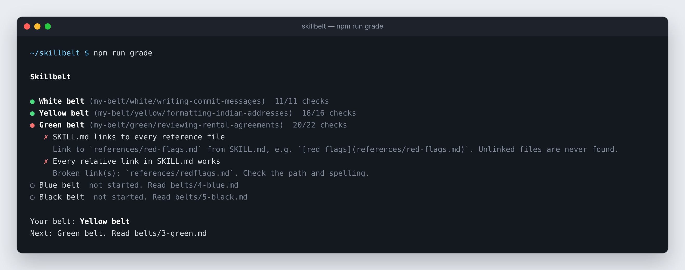
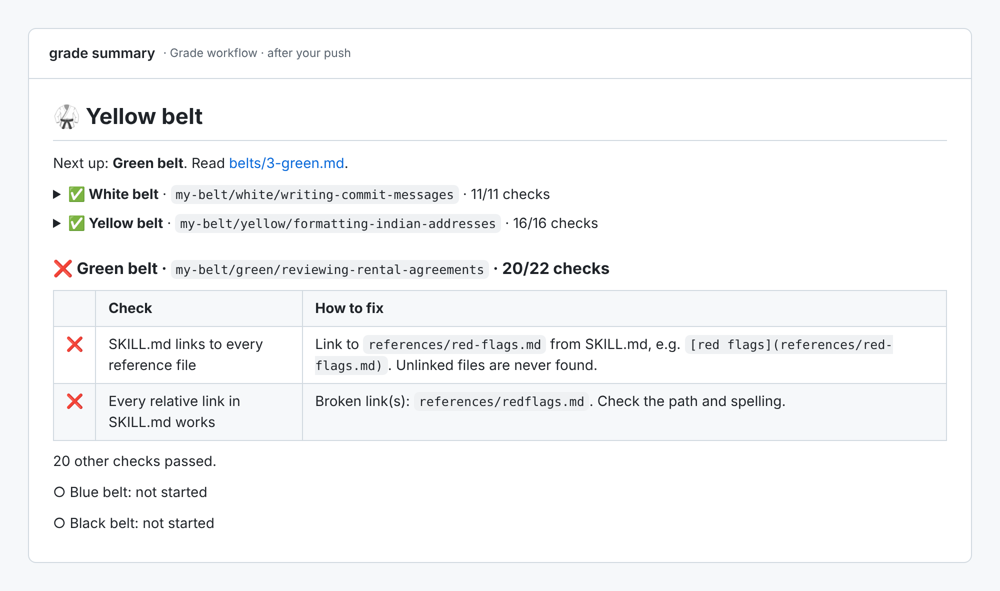
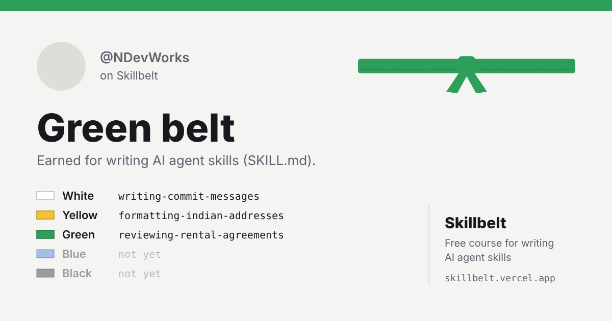

# 🥋 Skillbelt

**Learn to write AI agent skills by doing it. Five belts, a real grader, and a badge you earn on your own fork.**

    



A **skill** is a folder with a `SKILL.md` file that teaches an AI agent how to do one task well: reviewing leases, formatting invoices, converting files, following your team's release process. Claude Code and other agents that support the open [Agent Skills format](https://agentskills.io) load them automatically when a request matches.

Skills are easy to start and easy to get wrong. A vague description and the agent never uses your skill. A 2,000-line SKILL.md and it wastes tokens on every request. Skillbelt teaches the rules by having you write skills and checking them, one belt at a time.

**Just want to try it?** Open the **[playground](https://skillbelt.vercel.app)**: write a skill in your browser and watch the checks for every belt update as you type. No install, no sign-up, and you can share a link to your skill.

## How it works

1. **Fork** this repo.
2. In your fork, open the **Actions** tab and click **I understand my workflows, go ahead and enable them**.
3. Clone your fork and install:

   ```bash
   git clone https://github.com/YOUR-USERNAME/skillbelt.git
   cd skillbelt
   npm install
   ```

4. Read [the White belt lesson](belts/1-white.md) and write your skill in `my-belt/white/`.
5. Check it:

   ```bash
   npm run grade
   ```

6. Commit and push. The grader runs in your fork's Actions tab and updates your badge.

You need [Node.js 20+](https://nodejs.org). The Blue belt also accepts Python 3, if you prefer it. No API key or paid account is needed for any belt.

## The belts

| Belt | You learn | You build |
|---|---|---|
| [⚪ White](belts/1-white.md) | The SKILL.md format: frontmatter, naming, the rules every agent checks | Your first skill |
| [🟡 Yellow](belts/2-yellow.md) | Descriptions that make the agent pick your skill at the right time | A skill that triggers reliably |
| [🟢 Green](belts/3-green.md) | Progressive disclosure: a short SKILL.md with reference files | A skill with `references/` |
| [🔵 Blue](belts/4-blue.md) | Bundling scripts that fail loudly and clearly | `csv-to-table`, tested against real files |
| [⚫ Black](belts/5-black.md) | Evaluations, licensing, shipping | An original skill, then join the [Hall](BLACK_BELTS.md) |

Belts are earned in order. Each one adds rules to the ones before.

## What you see after a push

Every push runs the grader in your fork's **Actions** tab. Passed belts fold into one line, and each failed check tells you exactly how to fix it:



Locally, `npm run grade` shows the same report. Run one belt with `npm run grade -- yellow` to see every check that passed too.

## Show your belt

After your first push, add this to your GitHub profile README or your fork's README. Replace `YOUR-USERNAME` in both places:

```markdown
[](https://github.com/YOUR-USERNAME/skillbelt)
```

It updates itself each time you earn a belt.

## Share your belt card

Every belt you earn also gets you a card with your GitHub picture, your belt and the skills you wrote. After a push, the Actions summary links to it, or open `https://skillbelt.vercel.app/card/?u=YOUR-USERNAME`. Download the image for LinkedIn or X, or share the link.



## Hall of Black Belts

Earned every belt? Add yourself to [BLACK_BELTS.md](BLACK_BELTS.md) with a pull request. An automatic check confirms your badge before it's merged. See the [Black belt lesson](belts/5-black.md#join-the-hall-of-black-belts).

## Using your skills

Every skill you write here is a real, working skill. In **Claude Code**, copy a skill folder into `.claude/skills/` in a project (or `~/.claude/skills/` for every project) and start a new session. For other agents, check their docs for where skills go.

## Questions

**Do I need to know how to code?** Not for White, Yellow, Green or Black. Blue needs a short script in Python or JavaScript.

**Can I redo a belt?** Yes. Change your skill and push again. Your badge always shows the highest belt where every earlier belt also passes.

**The grader is wrong about my skill.** Open an issue with the skill and the message. See [CONTRIBUTING.md](CONTRIBUTING.md).

**Where do the rules come from?** The [Agent Skills specification](https://agentskills.io/specification) and Anthropic's [skill authoring best practices](https://docs.claude.com/en/docs/agents-and-tools/agent-skills/best-practices).

## License

[MIT](LICENSE)
